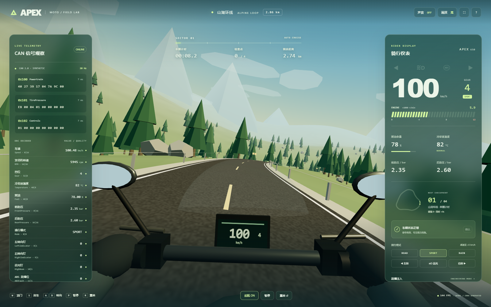

# APEX · MotorcycleHMI

摩托车第一视角 3D 骑行游戏，结合实时车辆信号与仪表展示。

**[在线试玩](https://stdwang.github.io/MotorcycleHMI/)** · [个人作品集](https://stdwang.github.io/penpenWeb/)



## 体验

- 山湖公路、第一视角摩托骑行与自动巡航。
- 跑圈计时、检查点、路障与碰撞反馈。
- 左侧磨砂玻璃 CAN 报文窗，右侧车辆仪表。
- 支持手机触屏、车辆状态切换与程序合成音效。
- 场景、模型、纹理和音效由代码生成。

## 操作

| 操作 | 按键 |
| --- | --- |
| 油门 / 刹车 | W / S 或上下方向键 |
| 转向 | A / D 或左右方向键 |
| 暂停 / 重来 | P / R |
| 左右转向灯 | Q / E |
| 远光灯 | L |

点击右上角开启声音。手机使用屏幕上的方向与踏板按钮。

## 本地运行

需要 Node.js 22 或更新版本。

```sh
npm run serve
```

打开 `http://127.0.0.1:4176/`。`npm run build` 生成可独立托管的 `dist/` 目录。

模型测试可运行 `npm test`。浏览器检查需先 `npm ci`，再运行 `npm run test:browser`（默认使用本机 Microsoft Edge）。

## 说明

本项目独立维护于 MotorcycleHMI 仓库。使用模拟车辆数据，供浏览器交互体验。

使用 [Three.js](https://threejs.org/) 渲染，许可证见 [THREE-LICENSE.txt](web/vendor/THREE-LICENSE.txt)。参考 [Starter-Kit-Racing](https://github.com/mrdoob/Starter-Kit-Racing) 的赛车组织思路。
